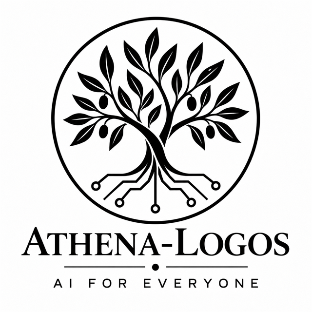
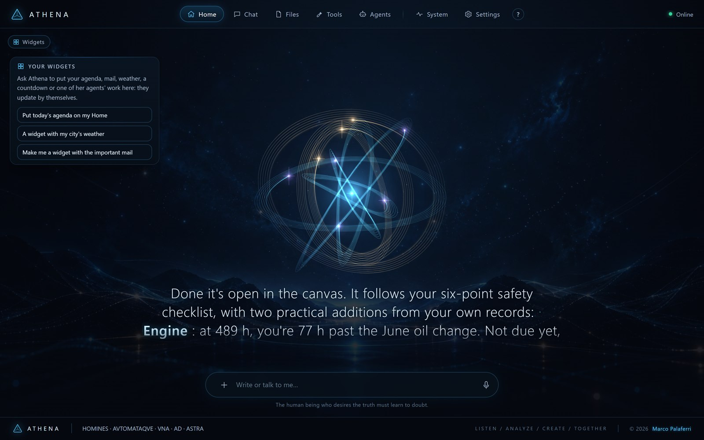
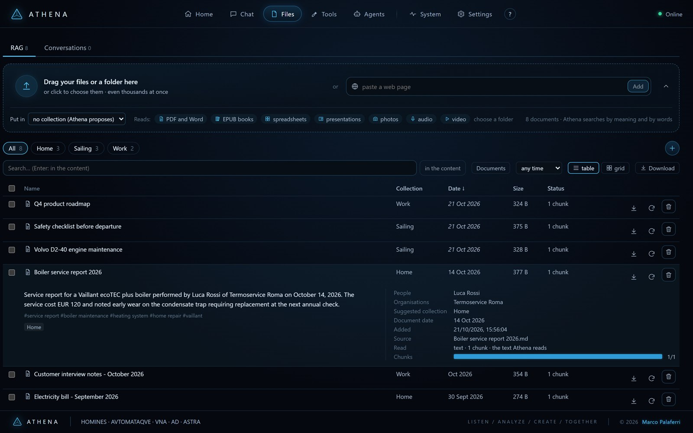
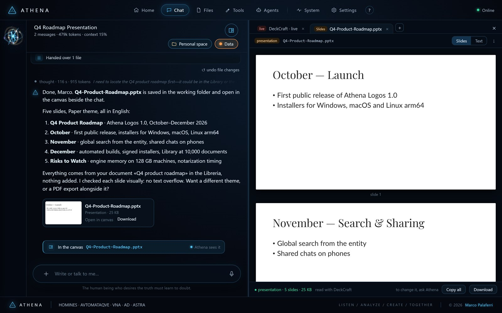
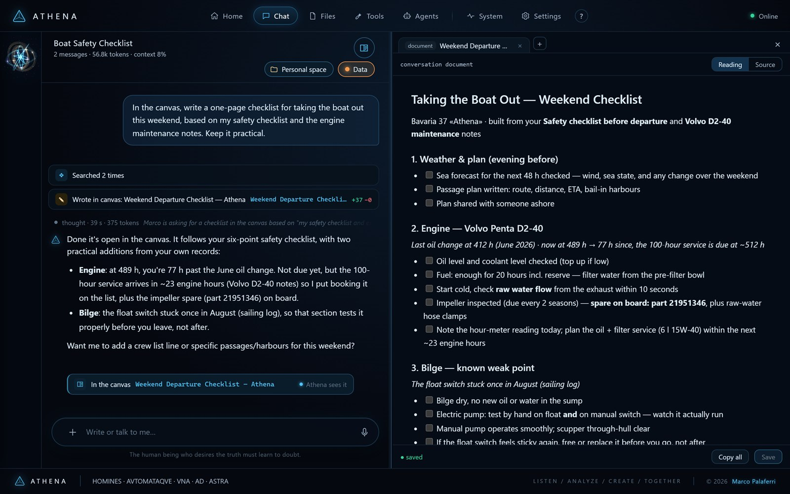
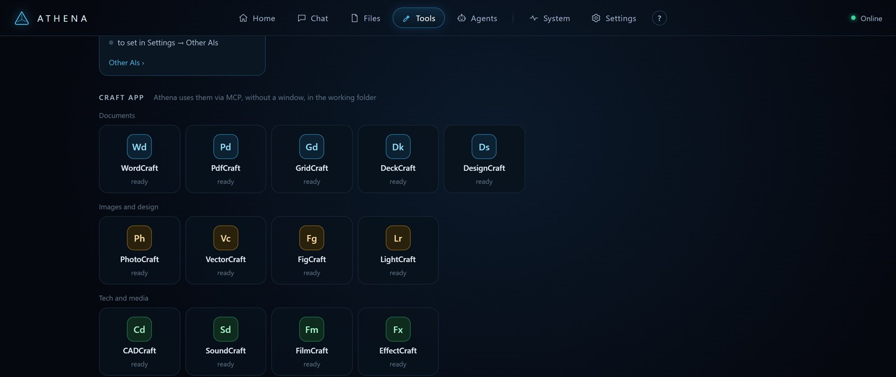
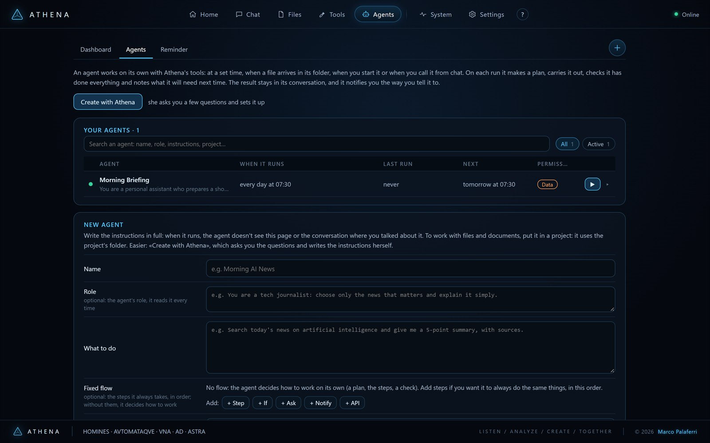
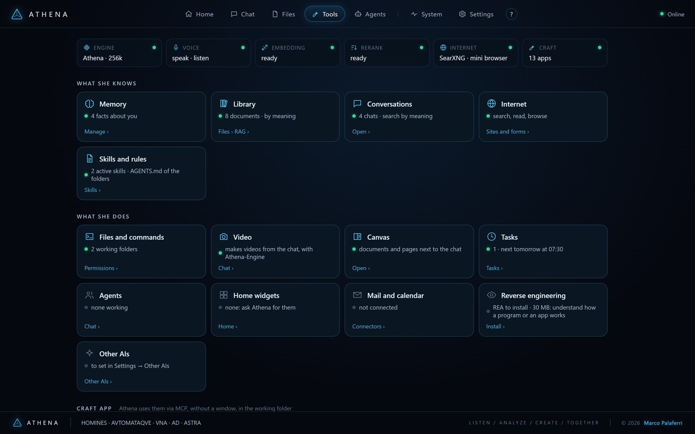
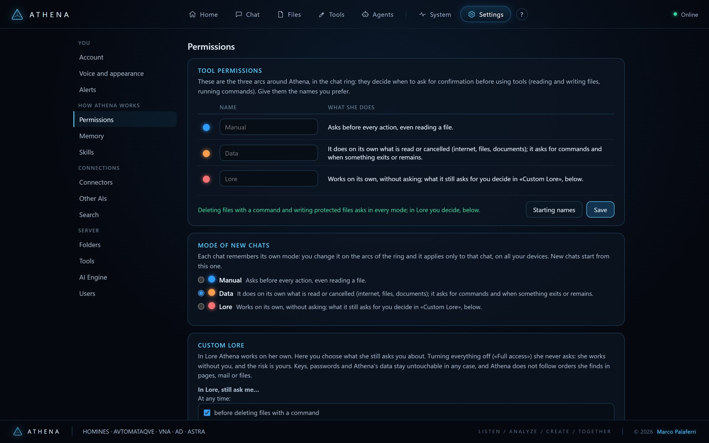

<p align="center">
  
</p>

<h1 align="center">Athena Logos</h1>

<p align="center">
  <b>HOMINES · AVTOMATAQVE · VNA · AD · ASTRA</b><br>
  <i>Humans and automata, together to the stars.</i>
</p>

<p align="center">
  <br>
  <sub>Home: Athena's presence, your widgets, and one box to write or talk.</sub>
</p>

## Why Athena Logos exists

I built Athena around a conviction: people should be able to use capable
AI and collaborate with it on computers they own, sharing knowledge,
developing ideas and working through problems together.

[Athena-Engine](https://github.com/xangel82/Athena-Engine) puts powerful
language models on a desk. **Athena Logos makes that collaboration part of
everyday work.** Talk to her. Bring your documents and your ideas. Work on a
project together. She has a voice, a memory, a Library and tools to help you
carry that work forward.

Athena Logos is the most complete expression of what I am building: an
assistant you can run on your own machines, reach from your phone and shape
around your work. Inside the app, she is simply **Athena**.

*Marco Palaferri, founder · [www.palaferri.com](https://www.palaferri.com/)*

## One assistant, two products

Athena Logos connects to an **OpenAI-compatible server**, running locally or
hosted elsewhere. Choose its address, model and API key in **Settings → AI
Engine**. For a local setup, pair Athena Logos with **Athena-Engine**.

**[Athena-Engine](https://github.com/xangel82/Athena-Engine)** runs the models
on your hardware. Long context, saved conversation caches, tool calls and
model switching give Athena the foundation for sustained work. The engine's
[README](https://github.com/xangel82/Athena-Engine#what-it-does) describes the
models, measured performance and hardware it supports.

With its companion services configured, Athena-Engine also provides voice,
transcription, Library embeddings and reranking, and video with sound on
DGX Spark or GX10.

**Athena Logos** is where you collaborate with Athena: conversation, documents,
memory, agents and the workspace where things get done. Run it beside the
engine or on another computer on your network, then open it in a browser.

**Start with both:** [set up Athena-Engine](https://github.com/xangel82/Athena-Engine#quick-start),
then [download Athena Logos](https://github.com/xangel82/athena-logos/releases/latest).
This repository contains the executables, installation guides and licence.
The source code is not public.

## Real use cases

These are things Athena has done, start to finish, in conversations on a home
server. Nothing was scripted in advance.

### A 3D printer that watches itself

*"There is a camera on my 3D printer. Can you get the video stream?"*

Athena probed the printer on the home network and read the code of its web
interface to find where the camera should be. The port was closed. She searched
the forums and found that a firmware update had removed the local video stream,
then explained the fix and its risks before touching anything. Once the owner
enabled root access from the printer's own screen, she read before writing,
started the video service that already ships in the firmware, and added one
small startup script. She checked its checksum and syntax and tested
start, stop and restart before putting it in place. The print kept going.

Then: *"Can you build an agent that checks the print and tells me if
something is wrong?"* Every 15 minutes, while the printer is printing, the
agent reads its status, compares two camera frames to make sure the head is
moving, and looks at the picture for spaghetti, a part coming loose or a jam.
It sends a Telegram message only when something looks wrong.

*Uses: commands on the PC, web search and pages, the camera frames read by
PhotoCraft, memory, an agent on a schedule, Telegram alerts.*

### From a sentence to a part you can print

*"I need a sloped channel with high sides for water, 10 to 15 cm long."*
Athena wrote the geometry, generated a closed, printable STL (150 × 60 mm,
20 mm sides, no supports needed) and drew the technical drawing in CADCraft
(section, side view and plan, as DXF). She handed the STL over in the chat,
ready to download for the slicer; changing four numbers regenerates it.

*Uses: CADCraft, files and commands in the working folder, file hand-over in
the chat.*

### Reading a whole book, then writing about it

A historical novel and a long essay sit in the Library. Asked what she thinks
of the novel, Athena read its opening, its middle and its ending, said
plainly that she had not read every word, and gave an honest review: what
works (the shipyard scenes, the mystery inside history, the dialogue) and what
could be tighter, quoting lines from the book. For the essay, she wrote a
2,300-word synthesis of its central idea in the canvas and, on request, turned
it into a Word document with WordCraft, rendering the pages to check the
formatting before saying it was done.

*Uses: the Library (search by meaning, reading part by part), the canvas,
WordCraft, memory.*

### An inbox that only speaks up when it matters

An agent watches a Gmail inbox. For every new email it decides whether it is
urgent (a payment problem, a deadline, a person waiting for an answer) or just
noise, keeps track of what it has already seen, and sends an alert only for
what needs a look. Most runs end with "nothing to report", which is the point.

*Uses: the Gmail connector, PdfCraft for attachments, the agent's own memory,
alerts.*

## What Athena does

### Talk naturally, follow the work

Speak hands-free in the browser, on a computer or a phone. Choose hold to
talk, an open microphone that lets you interrupt her, or listening that
resumes when she has finished. **Smart Turn** runs in the browser and helps
distinguish a pause from the end of your sentence. Athena uses the engine's
voice, with the device's system voice as a fallback. Her animated presence
lives in Home.

In chat, attach files or photos, use **/** commands and give her a direction
while she works. Reasoning and tool calls are visible. Answers carry source
links where available; Athena checks figures against the material at hand,
and **Verify** checks public facts against web sources when web search is
enabled.

### Make your Library useful

Bring in PDFs, including scans, Word files, spreadsheets, presentations,
EPUB books without DRM, web pages, photos, audio and video. Import whole
folders, including thousands of files, with queued processing and duplicate
detection. Office formats, OCR and media processing use the corresponding
**[Craft apps](https://getartcraft.com/apps)** installed on the server: free,
open-source apps by ArtCraft.

Athena reads text, describes images when the chat model supports vision,
transcribes speech and extracts video frames. Search combines words and
meaning, with reranking when the engine provides it. Answers point back to
the document and page, book chapter or moment in a recording.

Collections keep the Library organised. Athena writes summaries and proposes
where documents belong; you decide. The original files are also arranged in
readable folders on disk, and you can download a collection or the whole
Library as a ZIP.

<p align="center">
  <br>
  <sub>The Library: collections, and the card Athena writes for every document (summary, people, organisations, date, tags).</sub>
</p>

### Keep context across your work

Athena remembers preferences, people and decisions. You can inspect, correct,
add or remove what she remembers, and ask her to search earlier conversations.
Projects bring chats together with a working folder, instructions, their own
memory and selected Library collections. Long conversations are compacted
when they approach the model's context limit.

Share a chat with other users of your server and work together in the same
conversation and canvas. Personal memory stays out of shared chats; sharing
the working folder is a separate choice.

### Create beside the conversation

The **canvas** puts documents, Office files, audio, video, images, 3D models
and web pages beside the chat. Write with Athena in the open document,
select a passage to discuss, inspect a model or play a clip. With the Craft
apps, create and edit documents, spreadsheets, presentations and other files;
supported apps show the work live as Athena changes it.

<p align="center">
  <br>
  <sub>From a Library document to a presentation: Athena drives DeckCraft and opens the slides in the canvas.</sub>
</p>

<p align="center">
  <br>
  <sub>Writing together in the canvas, from your own documents.</sub>
</p>

<p align="center">
  <br>
  <sub>Thirteen Craft apps, used without opening a window, in the working folder.</sub>
</p>

Generate short videos **with sound** through Athena-Engine's LTX 2.5 service,
from a description or an image. Choose landscape, portrait, square, 4:3, 3:4,
HD 720p, Full HD 1080p (when the chat model can lend its memory, today Qwen)
or a custom size up to 1920 pixels per side. Jobs run in a queue, the chat
shows how far each one has got, and the finished clip arrives in the chat. Generate and edit images through a
configured Codex subscription, or generate new images with an OpenAI API
account.

### Give recurring work to agents

Create an agent by talking to Athena or with **/agent**. Give it a task,
documents, tools and skills. Run it on a schedule, when a file or email
arrives, after another agent, through a webhook or by hand. Agents keep their
own notes between runs; their dashboard shows live work, previous runs,
results, tests and versions. Reminders cover the smaller jobs. Telegram
alerts are available if you connect them.

<p align="center">
  <br>
  <sub>Agents: a morning briefing every day at 07:30, and a new one being written.</sub>
</p>

**Skills follow the open Agent Skills standard.** Create one with Athena,
import an existing skill or personalise one for your work. Personal skills
belong to you; administrators can also make skills available to everyone.

### Connect the tools you use

Search the web and navigate sites with a sandboxed mini browser. Read, write
and search files, or run commands in an allowed working folder when your
account has console permission. Connect **MCP servers** to extend the tools
Athena can use, or ask her to consult **Claude Code or Codex** in read-only
mode through your own subscription.

Connect mailboxes, Gmail and Google Calendar, Microsoft 365 and Outlook, or
your own services' APIs. Athena can find messages, work with appointments
and use those connections in agents. You supply the accounts and credentials
for the services you choose.

<p align="center">
  <br>
  <sub>Tools: what Athena knows and what she can do, at a glance.</sub>
</p>

## Safety lives in the harness, not in the model

A model can be talked into things: by a web page, an email, a document, or
by its own initiative. Athena's limits do not depend on the model agreeing to
them. They are enforced by the harness, the code that runs every tool she
calls, before the tool runs: the permission mode, the working folder, each
user's role, and the destinations you block. Nothing she reads and nothing
she writes can switch them off.

### Every call she makes outside, on record

**System → Network** is the trace of every call Athena makes outside your
machine in the last 30 days. It is taken from the server's own network layer,
not from what the model says it did: web pages, APIs, mail, Telegram and the
mini browser, each with the user, the chat and the tool that made it, the
domain, the IP, the outcome, and how much data went out and came in. Commands
that name a domain or an IP, or use a network program such as `curl`, `wget`
or `Invoke-WebRequest`, are listed too, with the action read from the command
(a `PUT`, a file upload).

The **Balance** view sums up the day, the week or the month: data out and in
hour by hour, and for every domain its calls, its volume and when it was last
reached. Domains that receive more than they send back are highlighted. A
normal read downloads a lot and sends little; an upload does the opposite.

### Block a domain, an address or a whole network

In **Settings → Network** the administrator lists blocked destinations: a
domain with its subdomains, a wildcard such as `*.example*`, a single
address, an IP, a network such as `203.0.113.0/24` or a range of IPs. Any row
of the trace has a **Block** button. Before a tool or a command reaches a
destination on the list, the harness stops it: the call never starts, the chat
shows why and the trace marks it in red. Athena takes it as a no from you. The
block applies in every permission mode, **Full access** included, and to
agents running on their own.

Know the limits. Programs Athena starts (commands, local MCP servers, Claude
Code and Codex) open their own connections, outside the server's trace. For
those, the trace keeps the command itself, and the check reads its text: a
destination hidden inside a script or encoded is not recognised. For a hard
wall, add a firewall on the machine.

## The machine, watched by the sentinel

Connect **Athena-Engine's sentinel** and the **System** page shows the engine's
machine live: GPU temperature, load and power, the GB10's unified memory,
disk, the engine's services and its log, with a warning when the GPU runs hot.
The **Models** tab lists every model configured in the engine by job (chat,
Library, voice, transcription, video): which ones are in memory and how large
they are. From there the administrator can stop and start the engine and see
what is using its memory.

### A different model in about a minute

The engine can keep several large models installed side by side, such as
Qwen, DeepSeek and a vision model. For the administrator, **Use this** on the
Models tab, or **/model** in the chat, switches the chat model for everyone
without restarting
anything: the engine releases the model in memory and loads the new one in
about a minute (45 seconds for the vision model in Athena-Engine's own
measurements). The chats show a notice. Answers already in progress finish
first, and new requests wait for the new model instead of failing. Choose
the model that fits the work in front of you.

The sentinel is safe by design. It runs a fixed list of actions, never
arbitrary commands and never `sudo`. It has its own token, separate from the
engine's API key, and refuses requests that come from a browser page: only
Athena's server talks to it.

## Control stays with you

Conversations, memory, the Library and working files are stored on the
computer running Athena Logos. Model requests go to the server you configure.
With a local engine, model processing stays on your machines. With a hosted
server, the conversation, attachments, document excerpts and tool results
included in a request are sent to that provider. Web searches, connected
services and external AIs also send the information needed for their requests
when you use them.

Three permission modes let you choose how Athena acts:

- **Manual:** asks before every action that uses a tool.
- **Data:** the default; asks for actions that send information, delete things
  or have lasting effects, while routine, reversible work can proceed.
- **Lore:** lets her work with fewer interruptions. Choose which confirmations
  to keep; **Full access** removes them.

<p align="center">
  <br>
  <sub>You choose how freely she acts, chat by chat.</sub>
</p>

Athena treats instructions hidden in pages, mail and documents as untrusted
content. Confirmation rules provide another boundary after she reads it.
These defences reduce risk; they are not a guarantee against prompt
injection or model mistakes.

File edits made through supported tools have **Undo**. Changes made by
commands cannot be undone that way. Administrators choose the server's
working area and grant users roles, folders and console access.

## Requirements

- A reachable **OpenAI-compatible server**: Athena-Engine or another compatible
  server, local or hosted. Tools and agents need a model that supports tool
  calling.
- A computer for **Athena Logos**: **Windows 10 or 11 x64**, **macOS on Apple
  Silicon** (M1 or later), or **Linux arm64** (tested on Ubuntu 24.04).
- A modern browser: Chrome, Edge, Safari or Firefox. Other computers, tablets
  and phones on your network can use the same server.

The executable includes its runtime: **no Node.js or Docker installation is
needed to start Athena Logos**. Hosting Athena-Engine has its own
[hardware requirements](https://github.com/xangel82/Athena-Engine#requirements),
currently NVIDIA GB10 systems with 128 GB of unified memory, such as DGX
Spark and ASUS Ascent GX10. Athena Logos can also connect to a different
OpenAI-compatible server from any of its supported computers.

Additional capabilities depend on the services available: compatible voice,
transcription, embedding and reranking services; a vision model for image
descriptions; and the relevant [Craft apps](https://getartcraft.com/apps)
(free and open source, by ArtCraft) for Office formats, OCR and media
processing. On Windows the ArtCraft Launcher installs them all and Athena finds
them by herself; on macOS and Linux Athena needs each app's command-line tool
(`wordcraft-cli` and the others), which the macOS builds do not ship yet.
Video generation uses Athena-Engine's LTX 2.5 service, and System
management uses its sentinel. Word search remains available without semantic
search. The mini browser uses an installed Firefox, Edge or Chrome; web
search uses a configured SearXNG instance.

The interface and built-in guide are ready in **English and Italian**. The
**?** at the top opens the guide for the page you are using.

## Download

Get the archive for your system from the
[latest release](https://github.com/xangel82/athena-logos/releases/latest):

| System | File |
|---|---|
| Windows x64 | `athena-logos-<version>-win-x64.zip` |
| macOS Apple Silicon | `athena-logos-<version>-macos-arm64.zip` — signed and notarized by Apple |
| Linux arm64 | `athena-logos-<version>-linux-arm64.tar.gz` |

`SHA256SUMS` lists the SHA-256 checksums of the release archives. Unpack the
archive and keep its folder together, including the licence and notices.

## Quick start

1. Start [Athena-Engine](https://github.com/xangel82/Athena-Engine#quick-start),
   or have the address, model name and API key of another OpenAI-compatible
   server ready.
2. Unpack Athena Logos and start the executable from a terminal. Follow the
   short guide for [Windows](docs/install-windows.md),
   [macOS](docs/install-macos.md) or [Linux](docs/install-linux.md). On Linux
   arm64, with the engine on the same machine at its default address:

   ```sh
   ./athena-logos-linux-arm64
   ```

   If the engine is elsewhere, set `ATHENA_ENGINE_URL` to its base address
   before starting; the platform guides show the commands. Keep the terminal
   open while Athena runs.
3. The terminal prints the address and, on first start, a **6-digit setup
   code**. Open `https://localhost:8080` on that computer, or
   `https://<server-address>:8080` from another device. With the default
   self-signed certificate, the browser asks you to accept it on first use.
4. Enter the setup code, create the administrator account and choose **where
   Athena can work**. Leaving the folder empty uses the home folder of the
   account running Athena.
5. Say hello. Add other accounts in **Settings → Users**.

The engine address, API key and engine certificate can also be configured in
**Settings → AI Engine**. For another compatible server, enter its API base
URL (usually ending in `/v1`) and the exact model name it serves. If using
environment variables instead, set `ATHENA_ENGINE_URL` without `/v1` and
`ATHENA_MODEL` to that model name.

## Recommended setup: a dedicated machine, reachable anywhere

Athena is at her best when she is always on. Install Athena Logos on a
**dedicated machine on your own network**, ideally the same DGX Spark or GX10
that runs Athena-Engine, or a small computer that never sleeps. Your agents
run on schedule, your Library and memory live in one place, and every device
you own talks to the same Athena.

To reach her away from home, use **[Tailscale](https://tailscale.com)**: a
private, encrypted network between your own devices, free for personal use.
Nothing is exposed to the internet and no router port needs opening.

1. Install Tailscale on the Athena machine and on your phone and laptop, and
   sign in with the same account.
2. In the Tailscale admin console, turn on **MagicDNS** and **HTTPS
   certificates**.
3. Run Athena on the machine itself and let Tailscale publish her with a real
   certificate:

   ```sh
   ATHENA_TLS=http ./athena-logos-linux-arm64
   sudo tailscale serve --bg 8080
   ```

4. Open `https://<machine-name>.<your-tailnet>.ts.net` from any of your
   devices. The certificate is valid, so there is no browser warning and the
   microphone works on phones too.

Prefer your own certificate? `tailscale cert` writes one for the machine's
name; start Athena with `ATHENA_TLS=cert`, `ATHENA_TLS_CERT` and
`ATHENA_TLS_KEY` pointing to those files. Either way, do not forward Athena's
port on your router: keep her inside your private network.

## Configuration

These environment variables are optional:

| Variable | Default | Purpose |
|---|---|---|
| `ATHENA_ENGINE_URL` | `http://localhost:30007` | Engine base address, without `/v1`. |
| `ATHENA_API_KEY` | Empty | Engine API key, if required. |
| `ATHENA_MODEL` | `Athena` | Model name served by the engine. |
| `ATHENA_PORT` | `8080` | Athena Logos port. |
| `ATHENA_TLS` | `auto` | `auto`: HTTPS with a self-signed certificate, redirecting HTTP on the same port; `cert`: your certificate, using `ATHENA_TLS_CERT` and `ATHENA_TLS_KEY`; `http`: plain HTTP, for use behind an HTTPS proxy. |
| `ATHENA_DATA_DIR` | `~/.athena-logos` | Conversations, Library, attachments and settings. |
| `ATHENA_WORKSPACE_ROOT` | Folder chosen at setup, otherwise the home folder | Server working area. This variable takes precedence over the setup choice. |
| `ATHENA_SEARCH_URL` | Empty, web search off | SearXNG instance with JSON output enabled. |
| `ATHENA_BROWSER` | `auto` | Mini browser: `auto`, `firefox`, `edge`, `chrome`, an executable path or `off`. |

Saved engine settings take precedence over their startup defaults. The
working area can be changed after setup only on the server, through
`ATHENA_WORKSPACE_ROOT` or `area.json` in the data folder.

If the engine uses HTTPS with a private certificate authority, place its root
certificate in the data folder as `engine-ca.pem`, or configure it in
**Settings → AI Engine**. HTTPS is needed for microphone access from other
devices.

## Updating and removing

- **Update:** stop Athena, replace the release folder with the new version
  and start it again. Your data stays in the separate data folder. Reload
  browser tabs; on a phone, close and reopen the tab if needed.
- **Remove:** stop Athena and remove any startup service you configured,
  then delete the release folder. Delete `~/.athena-logos` (or your chosen
  `ATHENA_DATA_DIR`) only if you also want to erase Athena's stored data.

## Licence

Athena Logos uses the same **[PolyForm Strict License 1.0.0](LICENSE)** as
Athena-Engine, with an additional permission for small companies:

- Free for noncommercial purposes, including personal study, research and
  hobby projects, and for the organisations covered by the licence.
- Internal business use is also permitted for companies with **fewer than
  30 employees and independent contractors in total**, and **less than
  USD 500,000 revenue in the prior tax year**.
- Redistribution, modified versions and offering the software to others as
  a product or service are not permitted. Other commercial use requires a
  separate licence; [open an issue](https://github.com/xangel82/athena-logos/issues)
  to get in touch.

The [licence text](LICENSE) is what applies. Third-party components retain
their own licences; see [THIRD-PARTY-NOTICES](THIRD-PARTY-NOTICES). Video
generation uses Lightricks' LTX 2.5 and is also subject to the
[LTX-2.x Community License](https://github.com/Lightricks/LTX-2/blob/main/LICENSE-2_x)
and its use restrictions. Entities with annual revenue of at least
USD 10 million need a paid licence from Lightricks, except for the limited
noncommercial purposes defined there.

## Problems and ideas

If the engine is offline, check **Settings → AI Engine**. If the microphone
does not work, check HTTPS, browser permission and **Settings → Voice and
appearance → Diagnostics**. If a Library format is unavailable, check that
its Craft app is installed; the Library shows which formats it can read.

For help, bugs or ideas, [open an issue](https://github.com/xangel82/athena-logos/issues)
with your operating system, Athena Logos version, what happened and what you
expected. Please leave credentials and private documents out of the report.
